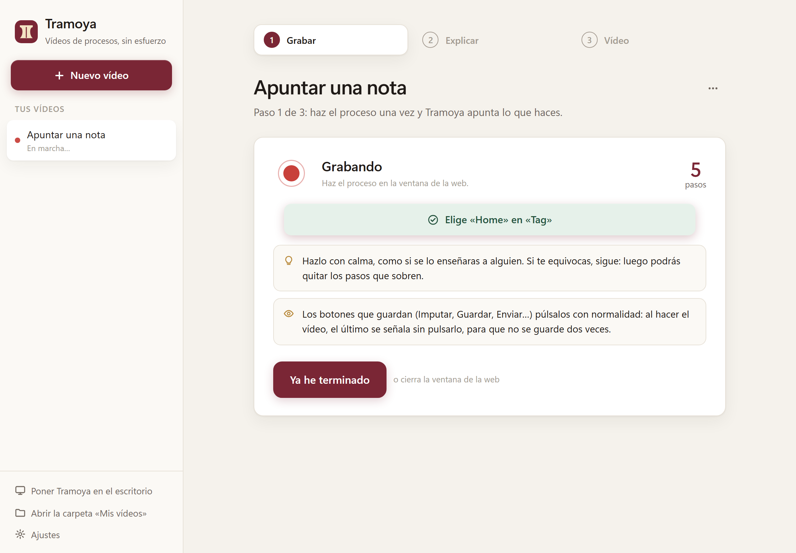
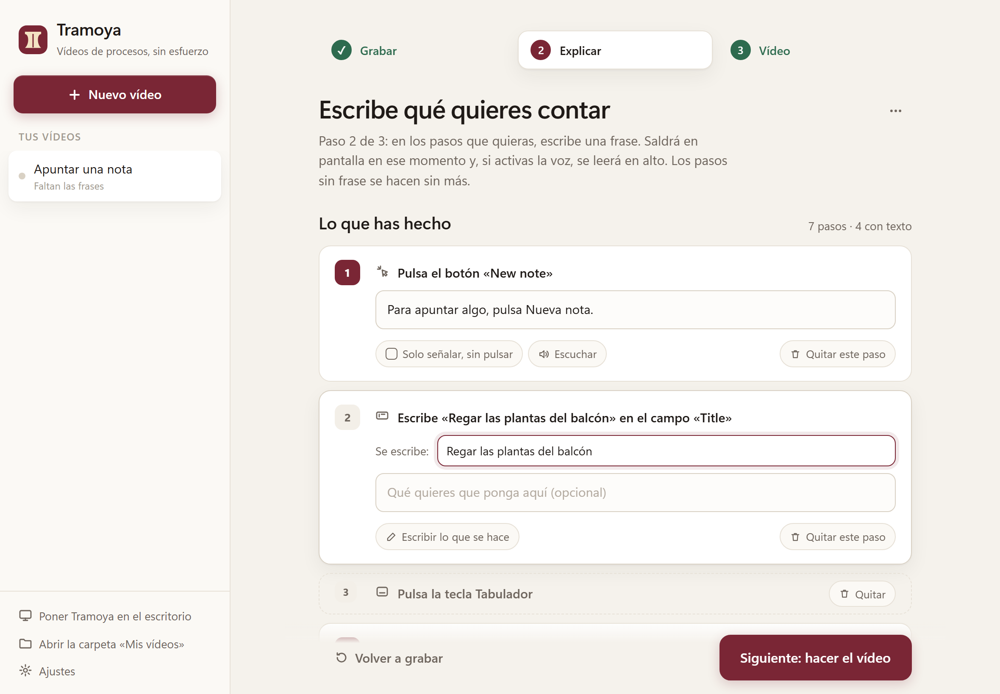

<div align="center">

<picture>
  <source media="(prefers-color-scheme: dark)" srcset="assets/logo-dark.png">
  
</picture>

<p>
<em>The <strong>tramoya</strong> is the machinery behind a stage: ropes, battens, trapdoors.<br>
The audience never sees it. The show runs on time because of it.</em><br>
<strong>This is that machinery for recorded software demos: you write scenes, it keeps the clock, the cursor, the voice and the cut.<br>Or you just say what you want: it works out the commands, or it clicks through the page itself.</strong>
</p>

<p>
  
  
  
  
  
  
  
</p>

<a href="#-tramoya-in-three-minutes"><strong>▶ Tutorial</strong></a> ·
<a href="#-your-first-video-step-by-step"><strong>Step by step</strong></a> ·
<a href="#-install"><strong>Install</strong></a> ·
<a href="#-no-terminal-tramoya-easy"><strong>No terminal</strong></a> ·
<a href="#-the-demo"><strong>The demo</strong></a> ·
<a href="#-your-app-in-one-file"><strong>Your app</strong></a> ·
<a href="#-where-it-earns-its-keep"><strong>Enterprise uses</strong></a> ·
<a href="#-scene-by-scene"><strong>Scene by scene</strong></a> ·
<a href="#-just-say-it"><strong>Just say it</strong></a> ·
<a href="#-windows-tramoyaexe"><strong>Windows</strong></a> ·
<a href="#-why-this-exists"><strong>Why</strong></a> ·
<a href="#-what-you-get"><strong>What you get</strong></a> ·
<a href="#-60-second-tour"><strong>60-second tour</strong></a> ·
<a href="#-the-pipeline"><strong>The pipeline</strong></a> ·
<a href="#-module-map"><strong>Module map</strong></a> ·
<a href="#-verification"><strong>Verification</strong></a>

</div>

---

<a href="#-the-pipeline"></a>

<div align="center">

**stage** Playwright · **recorder** wf-recorder or the browser itself · **voice** Kokoro · **cut** ffmpeg · **marks** one JSON file<br>
**core deps** none · **extras** `[playwright]` `[tts]` · **cli** `tramoya easy | init | capture | import | login | direct | snapshots | ask | do | marks | assemble | deck | captions | music | cues | record | tts`

<br>

<sub>Two kinds of image on this page. The logo and the diagram are <b>rendered</b> by
<code>scripts/render-assets.sh</code> from the palette in <code>assets/theme.conf</code> (the emblem itself was generated
once with a diffusion model and is kept under <code>assets/brand/</code>). Everything else is <b>real output</b>: the
terminal GIFs are <code>asciinema</code> recordings of the installed command, the demo video was directed, recorded,
voiced and assembled by this package from the example under <code>examples/</code>, and the filmstrip is six frames cut
out of that take at the marks it wrote. No mock-ups, nothing hand-painted. tramoya made its own README.</sub>

</div>

---

## 🎥 Tramoya in three minutes

**You do the process once. Tramoya turns it into a narrated video.** Or you just *describe* the process, and an AI
does it for you on the real page, writes what the voice will say at every step, and hands you the video.
Or you *ask* it where something is, and it takes you there and points.

This is the tutorial of the Windows app, and it was made the only way that felt honest: **Tramoya recorded
itself**. Its own window, a fresh install, every button pressed by a script, the voice read by Windows, the cut done
by `assemble`. Inside the tutorial, the AI records a second video of its own, on the notes app of the examples.

<p align="center">
  <a href="assets/video/tramoya-tutorial.mp4"></a>
</p>

<p align="center"><sub>Preview GIF (no sound). <a href="assets/video/tramoya-tutorial.mp4"><b>▶ Watch the tutorial with narration</b></a> (Spanish voice, 3:10) ·
<a href="assets/video/tutorial-the-ai-made-this.mp4"><b>▶ The video the AI made inside it</b></a> ·
<a href="assets/video/ask-where.mp4"><b>▶ «Where are my finished notes?»: asking instead of recording</b></a></sub></p>

| What you see in the tutorial | What it means for you |
|---|---|
| **Settings**: a Windows voice, its speed, a *listen* button, subtitles on or off | The voice is the one already on your PC. No account, no upload, no microphone. |
| **A new video**: a name and the address of a web page | Any web page: your intranet, a SaaS tool, an app on `localhost`. |
| **«O pídeselo a la IA»**: a sentence typed, one button | The AI opens the page, reads it, decides every click and writes every sentence. A local model is enough. |
| **The steps it wrote**, each with its sentence | Nothing is final: you fix a sentence, drop a step, or mark a button as *only point at it*. |
| **The video**: replayed, voiced, cut | An `.mp4` and an `.srt` in *Vídeos\Tramoya*. Re-make it after the next UI change in two clicks. |
| **The long waits are sped up**, with a «7 minutos después» caption | The AI worked on the page for seven minutes and the render took one; the tutorial does not make you watch either. |

[`examples/tramoya-sobre-tramoya/`](examples/tramoya-sobre-tramoya) is that tutorial as a profile and a script:
`bash grabar.sh` records it again, on your machine, in about six minutes.

---

## 👣 Your first video, step by step

Written for the person who knows *the process* (how to file an expense, approve a request, set up a report) and has
never opened a terminal. Windows, no admin rights, nothing to install. The window speaks Spanish; the button names
below are the ones you will see.

**1. Download it.** From the [latest release](https://github.com/gitsual/tramoya/releases/tag/v0.6.0-rc4), take
`Tramoya-0.6.0-windows.zip` (545 MB: the program, its own Chromium and ffmpeg, so it downloads nothing later).
Behind a network that cuts big downloads, take instead the six pieces `….zip.part0` … `part5` plus `unir.bat`,
put them in the same folder and double-click `unir.bat`: it joins them and unzips.

**2. Open it.** Unzip anywhere (your *Documents* is fine) and double-click **`Tramoya.exe`**. The program is not
signed yet, so Windows shows a blue *SmartScreen* box the first time: *Más información* → *Ejecutar de todas formas*.
The Tramoya window opens. Its settings and your projects live inside that folder (delete it and nothing is left behind); the finished videos go to *Vídeos\Tramoya*.

**3. Grabar: do it once.**
- Press **Empezar un vídeo**, give the video a name («Cómo se pide un día libre») and paste the address of the web page.
- Press **Abrir la web**. A browser opens: sign in as you always do, and go to where the process starts.
- Press **Empezar a grabar** and do the process once, calmly. Mistakes are fine, you can remove them later.
- Close that browser when you are done.

> [!TIP]
> Nothing is recorded before *Empezar a grabar*, so **your password never ends up in a video**. The browser
> remembers the session, so the next video starts already signed in.

**4. Explicar: say what the voice says.** Every click, typed value and choice comes back as a plain sentence
(«Pulsa el botón «Guardar»»). Under each step there is a box: write what the narrator should say there, and press
the speaker to hear it. You can also change a typed value (put a fake name instead of a real one), delete the steps
that were mistakes, and mark a button as **solo señalar**: the video points at it without pressing it. The last
button that saves is marked that way already, so making the video never saves anything twice.

**5. Vídeo: press the button.** Choose the voice, press **Hacer el vídeo** and wait a couple of minutes. Tramoya
repeats your steps on the page by itself (the cursor travels, the captions change), reads your
sentences and cuts the video. When it finishes, **Abrir el vídeo** plays it; the file is in *Vídeos\Tramoya*, with
its subtitles next to it. If a step fails, the window tells you which one and why, and takes you there.

**Or skip step 3: pídeselo a la IA.** If a model is reachable (see below), the recording screen has a card
**«O pídeselo a la IA»**. Describe the process in one or two sentences, the way you would ask a colleague:
*«Enseña cómo se apunta una nota: pulsa Nueva nota, escribe el título Compra, guárdala y márcala como hecha.
Explica cada paso con una frase corta.»* The AI does it on the real page and leaves the steps and sentences in step 4,
for you to review as if you had recorded them.

**Or ask it a question.** Type a question instead («¿Dónde veo las notas que ya he terminado?») and the AI does not
run a process: it takes you to the exact place, **points** at it without pressing, says what it is for, and the
answer closes the video. That is the 15-minute tutorial nobody watches, turned into the 40-second answer to the one
thing you needed.

<details>
<summary><b>What the AI needs, and what happens without it</b></summary>

The AI cards need a language model. Either a local one with [Ollama](https://ollama.com) (`ollama pull
qwen3-coder:30b`; it runs on your PC, nothing leaves it) or the Claude API (`ANTHROPIC_API_KEY` set in Windows).
Without a model the cards simply do not appear and everything else works exactly the same: recording, sentences,
voice and video never needed one.

The model reads what the page says: the text of its buttons and their `title` / `aria-label`. Pages whose buttons
say what they do get better videos and better answers.
</details>

<details>
<summary><b>When something goes wrong</b></summary>

| You see | Do this |
|---|---|
| «La sesión ha caducado» | Press *Abrir la web*, sign in again, close the browser, and make the video again. |
| A step fails («no encuentro el botón…») | The page changed, or the step was a one-off (a pop-up that only appears sometimes). Delete or re-record that step. |
| The window opens blank on a company laptop | The window uses Edge's engine without a proxy; if a policy still blocks it, tell your IT that Tramoya only talks to `127.0.0.1`. |
| SmartScreen or the antivirus stops `Tramoya.exe` | It is not signed yet. *Ejecutar de todas formas*, or ask for it to be allowed. |
| The voice sounds robotic | *Ajustes*: try another Windows voice and a slower speed. Windows has better voices under *Settings → Time & language → Speech*. |
</details>

<details>
<summary><b>🇪🇸 La misma guía, en español</b></summary>

Para quien sabe hacer el proceso y nunca ha abierto una terminal. Windows, sin permisos de administrador, sin
instalar nada.

1. **Descárgalo.** De la [última versión](https://github.com/gitsual/tramoya/releases/tag/v0.6.0-rc4), baja
   `Tramoya-0.6.0-windows.zip` (545 MB, lo lleva todo dentro). Si tu red corta las descargas grandes, baja las seis
   partes `….zip.part0` … `part5` y `unir.bat` a la misma carpeta y haz doble clic en `unir.bat`.
2. **Ábrelo.** Descomprime donde quieras y doble clic en **`Tramoya.exe`**. La primera vez Windows avisará de que no
   está firmado: *Más información* → *Ejecutar de todas formas*.
3. **Grabar.** *Empezar un vídeo*, un nombre y la dirección de la web. *Abrir la web*, entra con tu usuario como siempre y ve
   hasta donde empieza el proceso. Pulsa **Empezar a grabar** y hazlo una vez. Antes de ese botón no se apunta
   nada: tu contraseña nunca sale en un vídeo.
4. **Explicar.** Cada paso vuelve como una frase sencilla. Escribe debajo lo que dirá la voz y escúchalo; cambia un
   valor (un nombre de ejemplo en vez del real), quita los pasos que sobran o marca un botón como **solo señalar**
   para que el vídeo lo señale sin pulsarlo.
5. **Vídeo.** Elige la voz y pulsa **Hacer el vídeo**. En un par de minutos está en *Vídeos\Tramoya*, con sus
   subtítulos al lado. Cuando cambie la web, lo vuelves a hacer con dos clics.

**O pídeselo a la IA:** describe el proceso como se lo pedirías a un compañero, y la IA lo hace en la web y te deja
los pasos con sus frases para revisarlos. **O pregúntale** «¿dónde está…?», y te lleva hasta allí, lo señala y te
lo explica.
</details>

---

## ✂️ In three lines

```bash
pip install "tramoya[playwright,tts] @ git+https://github.com/gitsual/tramoya@v0.5.0"
tramoya init my-demo --url http://localhost:3000/ --scene "welcome: The dashboard" --scene "export: Export a report"
cd my-demo && tramoya capture http://localhost:3000/ --into tramoya.toml && make
```

That is the whole loop for **your** app: a few questions write `tramoya.toml`, a real browser records what you
click and turns it into scenes, and `make` records the take, voices the script and cuts the video. No Python to
write. The rest of this page shows what happens in between, with the real output at every step.

If you would rather describe than type: `tramoya do "record the notes app demo, give it an English voice and build
the final video"` works out the commands and asks before running them.

---

## 🪄 No terminal: `tramoya easy`

For the person who knows the process and has never opened a terminal. A window, in Spanish, three steps:

<p align="center">
  
  
</p>

1. **Grabar.** Paste the address of any web page and press *Abrir la web*. Sign in as usual, go to where the
   process starts, press *Empezar a grabar* and do it once. Nothing is recorded before that button, so a password
   never is; the browser profile is kept, so the next video is already signed in.
2. **Explicar.** Every click, typed value, choice and key comes back as a sentence ("Pulsa el botón «Guardar»").
   Write what to say on the steps that need it, listen to it, change a typed value, drop the steps that were
   mistakes, or mark a button as *solo señalar* so the replay points at it without pressing it (the last saving
   button is marked that way by default, so the replay never saves twice).
3. **Vídeo.** tramoya replays the steps on stage, reads the sentences with a Windows voice (SAPI, offline) and
   assembles the video, plus an `.srt` next to it. A step that fails is named, with the reason, and the window
   takes you to it.

No model is involved. Selectors come from Playwright's own generator (role and accessible name first, never the
generated ids that change on every page load), iframes are followed, cookie banners become optional steps, Windows
integrated sign-in is allowed for the site's own domain, and a session that expired is reported as such instead of
as a missing button.

```bash
pip install "tramoya[easy] @ git+https://github.com/gitsual/tramoya@v0.5.0"
python -m playwright install chromium
tramoya easy                      # alias: tramoya facil
```

On Windows there is no Python to install: **`Tramoya.exe`** is the same app as a native program (see
[Windows](#-windows-tramoyaexe)). Double-click it and the window opens; unzip the kit with Chromium and ffmpeg
inside on a locked-down laptop (no admin, a proxy that cuts big downloads). The Python portable kit of v0.5.0
(`python scripts/build_easy_kit.py`) is superseded by it.

---

## 🎬 The demo

A one-page notes app, six scenes, under a minute. Every frame below was produced by the pipeline: the profile drove
the page, the browser recorded itself, Kokoro read the script, `assemble` cut it per scene and fitted the voice.

<p align="center">
  <a href="assets/video/notes-demo.mp4"></a>
</p>

<p align="center"><sub>Preview GIF (8 fps, no sound). <a href="assets/video/notes-demo.mp4"><b>Watch the full video with narration</b></a> (48 s, h264 + aac).</sub></p>

### How it was made, start to finish

This is tramoya running over the notes app from a single sentence. Nothing is staged: the terminal is a real
recording of the installed command, and the video at the end is the file it produced.

<p align="center">
  <a href="assets/video/walkthrough.mp4"></a>
</p>

<p align="center"><sub><a href="assets/video/walkthrough.mp4"><b>Watch the walkthrough</b></a> (73 s, h264 + aac): the request, the run, and the result.</sub></p>

**Before.** The folder holds sources only, and none of them is a video:

```
examples/notes-app/
├── index.html     the app under demo: a one-page notes list, no build step
├── tramoya.toml   the profile: where the app lives and six scenes as one-line steps
├── script.json    what the voice says, one entry per scene, per language
├── snapshots/     the approved accessibility snapshot of each scene
└── director.py    the same six scenes written as Python, for when a step is not enough
```

**During.** One request, and the assistant turns it into a plan, checks it, and runs it step by step:

```
$ tramoya do "record the notes app demo, give it an English voice and build the final video" --yes

1. Record the demo
   $ tramoya direct tramoya.toml --out demo --lang en
2. Generate voice clips
   $ tramoya tts --script demo/script.json --lang en --out-dir voices
3. Assemble final video
   $ tramoya assemble --video demo/take.webm --marks demo/marks.json --voice-dir voices --out final-demo.mp4
```

Nobody told it to use the profile: it found `tramoya.toml` in the folder. `direct` runs it: a headless Chromium
opens `index.html`, the injected cursor travels and clicks, the caption band changes per scene, the browser
records itself, and the director writes `marks.json`, the script and one snapshot per scene as it goes.
`tts` reads that script through Kokoro, one wav per scene. `assemble` cuts the take at the marks, fits each
scene to its clip and concatenates.

**After.** The folder now has the take, the marks, six voice clips and `final-demo.mp4`, and the terminal shows
the per-scene table `assemble` printed:

```
scene welcome:    7.6s raw ->    7.8s final
scene search:     6.7s raw ->    6.7s final
scene new-note:  10.8s raw ->   10.8s final
scene done:       7.1s raw ->    7.1s final
scene views:      8.4s raw ->    8.4s final
scene closing:    7.3s raw ->    7.5s final
assembled final-demo.mp4
```

The demo at the top of this section is the same profile through the same three commands.

## 🎞️ Scene by scene

One frame per scene, cut out of `take.webm` at the midpoint of each `scene:<name>` pair in `marks.json`. The
caption under each frame is the label the director wrote when the scene started, so the strip is also a check that
the marks land where the story says they do.

<p align="center">
  <a href="examples/notes-app/tramoya.toml"></a>
</p>

<p align="center"><sub>Rendered by <code>scripts/render-assets.sh filmstrip</code> from the take and the marks. Re-record the demo and the strip follows.</sub></p>

### The same thing by hand

The whole thing lives in [`examples/notes-app/`](examples/notes-app): a self-contained `index.html`, a
`script.json` with one line per scene, and a `director.py` of under a hundred lines. Reproduce it from scratch:

```bash
uv pip install -e ".[dev,playwright,tts]" && uv run python -m playwright install chromium

cd examples/notes-app
tramoya direct tramoya.toml --out out      # the six scenes as step lines  -> take.webm, marks.json, snapshots/
tramoya direct director.py  --out out      # or the same six scenes as Python (see director.py)
tramoya tts --script script.json --lang en --out-dir out/voices/en          # one wav per scene
tramoya marks out/marks.json                                                # the scene table
tramoya assemble --video out/take.webm --marks out/marks.json --voice-dir out/voices/en --out out/demo.mp4
```

`--rehearse` runs the same choreography in a few seconds without recording, and `--pace 0.7` slows the whole
take down. The director is what a product would write: scenes are functions, and every scene gets the stage and a
`say` callback that plays that scene's clip (or waits its length when the clip is missing).

---

## 🧭 Your app in one file

A demo of your own app is a `tramoya.toml`: where the app is, how to reach it, and the scenes. No director script
unless you want one.

```toml
[app]
name = "Notes"
launch = "python -m http.server 8770 --bind 127.0.0.1"   # optional: tramoya starts it and waits for `url`
url = "http://127.0.0.1:8770/index.html"
viewport = [1280, 720]
# storage_state = ".tramoya/auth.json"                     # a saved session for demos behind a login

[demo]
languages = ["en", "es"]
pace = 1.0

[[scene]]
name = "search"
label = "Search filters as you type"
steps = ["type #search | re", "say 5", "point .note .title", "beat 1", "clear #search"]

[scene.narration]
en = "Typing in the search box filters the list as you go."
es = "Al escribir en el cuadro de búsqueda la lista se filtra al momento."
```

```bash
tramoya direct tramoya.toml --out out --dry-run     # the plan, scene by scene, nothing opens
tramoya direct tramoya.toml --out out               # take.webm · marks.json · script.json · snapshots/<scene>.txt
tramoya direct tramoya.toml --out out --url https://staging.example.com/   # same scenes, another deployment
```

**Steps are one line each.** Eleven verbs cover a demo; the stage does the cursor travel, the click ripple and
the caption for you.

| Step | Does |
|---|---|
| `click <selector>` · `click_text <text>` | Move the cursor there, ripple, click. Selectors are Playwright's: CSS, `text=`, `role=button[name="Save"]`. |
| `type <selector> \| <text>` · `select <selector> \| <value>` · `clear <selector>` | Fill, pick an option, empty a field (and fire `input`). |
| `point <selector>` | Scroll it into view and rest the cursor on it. |
| `scroll <px>` · `press <key>` · `goto <path>` | The obvious; `goto` is relative to the app's URL. |
| `say [seconds]` | Play this scene's narration in the chosen language, or wait `seconds` when there is no clip yet. |
| `beat <seconds>` | A pause, scaled by `pace`. |

<p align="center">
  
</p>

<p align="center"><sub>Recorded by <code>scripts/render-assets.sh init</code>: <code>init</code> from flags, <code>import</code> of a recording, the plan, and the snapshot gate failing on a renamed heading.</sub></p>

**Three ways to get the file written.**

| | Command | When |
|---|---|---|
| **Ask me** | `tramoya init <dir>` | A short interview (every question has a flag, so it also runs in CI with `--no-interactive`). Writes `tramoya.toml`, `script.json` with one empty narration per scene and language, and a three-target `Makefile`. |
| **Watch me** | `tramoya capture <url> --into tramoya.toml` | Opens a real browser through `playwright codegen`; what you click becomes step lines, one scene per page you navigate to. |
| **Import** | `tramoya import flow.json --into tramoya.toml` | The same from a Chrome **DevTools Recorder** export or a `playwright codegen` Python file you already have. |

**Behind a login.** `tramoya login <url> --out .tramoya/auth.json` opens a browser, you sign in, you press
Enter, and the cookies and local storage are saved as a Playwright session file. The profile points at it with
`storage_state`; the password never touches tramoya, a file, or a prompt. Add `.tramoya/` to `.gitignore`.

**The assistant knows the profile.** With a `tramoya.toml` in the folder, `tramoya ask` and `tramoya do` read
it, so *"record the demo in Spanish and build the video"* becomes `direct tramoya.toml`, `tts --lang es`,
`assemble` with the right files, and preflight already knows what each step will write.

**A snapshot per scene, so CI notices.** Every `direct` run writes `snapshots/<scene>.txt`: the page's
accessibility tree at the end of the scene, as Playwright renders it.

```
- banner:
  - heading "Notes" [level=1]
  - textbox "Search notes"
  - button "New note"
- main:
  - article:
    - text: Quarterly report Draft the numbers before Thursday work
    - button "Done"
```

Commit the approved set and add one line to CI: `tramoya snapshots diff approved/ out/snapshots`. A renamed
button, a missing note, a scene that never ran, each shows as a unified diff and a non-zero exit, before anyone
publishes a video of the wrong build. This repository does exactly that for its own example on every push.

---

## 🏢 Where it earns its keep

Screen-recording tools make a video of what someone did once. tramoya makes a video of what the **build does now**,
from a file in the repository, on every run. That difference is worth money in a few specific places.
[`examples/`](examples/README.md) has a runnable profile and a copy-ready workflow for each.

| Use | The problem it fixes | What tramoya adds | Example |
|---|---|---|---|
| **Validation evidence** in regulated QA | Guidance such as the FDA's Computer Software Assurance draft accepts a recording of the run as objective evidence instead of a screenshot per step, but only if the recording is of the build under test. | One scene per test step, labelled with its id; the accessibility snapshot of each step diffed against the approved set; take, marks and snapshots kept as the evidence bundle. Re-run, never edited. | [`validation-evidence/`](examples/validation-evidence) |
| **Release-note video** per tag | Changelogs are already generated in CI; the video is the artifact nobody has time to record, so it ships late or not at all. | A workflow on `v*` tags records the changelog scenes against the tagged build and attaches one video per language to the release. | [`release-notes/`](examples/release-notes) |
| **Support knowledge base** that does not rot | Every UI change silently outdates a help video, and the first person to notice is a customer. Vendors in this space report fewer support calls once a video KB exists. | Short "how do I" scenes regenerated nightly against `main`. When the UI changes, the video changes. | [`support-kb/`](examples/support-kb) |
| **Localized onboarding** | Re-shooting a demo per language is where the cost of training video goes; vendors' headline savings come from not doing it. | One take, one `tts` + `assemble` per language, the cut adapts to each voice. English and Spanish ship here. | [`localized-onboarding/`](examples/localized-onboarding) |
| **Sales demos that stay true** | Recorded demos drift from the product between releases. | Re-record on each release from the same profile. tramoya wins the "always truthful" slice only; interactive demo tools still own click-through and analytics. | any profile with `--url` at staging |

Sources and the honesty notes behind this table (which figures are vendor-published, what could not be
confirmed) are in
[`docs/research/2026-09-28-target-app-interactive-setup-enterprise-value.md`](docs/research/2026-09-28-target-app-interactive-setup-enterprise-value.md).

---

## 🗣️ Just say it

You do not have to learn the commands. Describe what you want; a language model turns it into a plan of
`tramoya` commands, the plan is checked against the files that actually exist, and nothing runs until you say so.

<p align="center">
  
</p>

```bash
tramoya ask "put some quiet background music under demo.mp4"     # shows the plan, runs nothing
tramoya do  "build the video with the English voice"             # shows the plan, asks, then runs it
tramoya do  "…" --yes --dry-run                                  # runs it, but every ffmpeg call only prints
```

Three real exchanges, verbatim from the GIF above, with a small local model (`qwen3-coder` through Ollama):

<table>
<tr><th width="34%">You say</th><th>What happens</th></tr>
<tr>
<td><code>put some quiet background music under demo.mp4</code></td>
<td>A two-step plan: synthesize the bed with <code>tramoya music bed --out bed.wav</code>, then
<code>tramoya music mix --video demo.mp4 --bed bed.wav --out demo-with-music.mp4</code>. Each step carries a one-line <em>why</em>.</td>
</tr>
<tr>
<td><code>translate the video into French</code></td>
<td>No steps. The answer explains that voices exist only for English and Spanish, so the request cannot be fulfilled.
The model is told the rule, and <code>preflight</code> would refuse the plan anyway if it tried.</td>
</tr>
<tr>
<td><code>show me the scenes, then build the video with the English voice</code></td>
<td>Two steps: <code>tramoya marks marks.json</code> prints the six-scene table, then <code>assemble</code> cuts the take,
fits each voice clip and writes <code>final-demo.mp4</code>. With <code>--yes</code> it runs straight through.</td>
</tr>
</table>

**Two backends, same plan.** Local and private by default, hosted when you ask for it:

| Backend | How to pick it | Model |
|---|---|---|
| **Ollama** (local) | default when no key is set; `--backend ollama`; `TRAMOYA_LLM=ollama` | `qwen3-coder`, or `--model` / `TRAMOYA_LLM_MODEL` (`OLLAMA_HOST` to point elsewhere) |
| **Claude** (API) | `ANTHROPIC_API_KEY` set; `--backend claude`; `TRAMOYA_LLM=claude` | `claude-sonnet-5`, or `--model` / `TRAMOYA_LLM_MODEL` |

**What keeps it honest.** The model only proposes; the package decides.

- The model sees the command reference and the files in the current directory, and answers in strict JSON. A reply
  that is not a plan gets **one repair round**, then the error is yours to read.
- **Preflight** rejects a plan before anything runs: an input that does not exist, a language with no voices, a
  file used as a narration script that is not one, a `direct` step with no director script. It also knows what
  each step produces, so `assemble` may consume the `take.webm` that `direct` will write two steps earlier.
- `run_plan` executes **only `tramoya` commands**, in order, and stops at the first failure. Nothing else the model
  writes is ever passed to a shell.
- `tramoya do --dry-run` appends `--dry-run` to every step that would encode, so the whole plan can be inspected
  as ffmpeg argv first.

---

## 🪟 Windows: `Tramoya.exe`

The Windows version is the whole tool rewritten in C#/.NET 9 (`windows/`), one signed executable instead of a
300 MB Python kit, built for locked-down laptops where nothing can be installed. Linux and macOS keep the Python
package. Both read and write the same files (`tramoya.toml`, `marks.json`, `script.json`, the step language, the
projects of `easy`), so a profile written on one runs on the other, and the Python test suite is the spec the
port is checked against.

```
Tramoya.exe                     the window (tramoya easy): WebView2 over a local server, no browser profile games
Tramoya.exe direct tramoya.toml --out out      every CLI command works too; the console is attached when there are args
Tramoya.exe tts --script out/script.json --lang es --out-dir out/voices/es    Windows voices (SAPI), offline
Tramoya.exe assemble --video out/take.webm --marks out/marks.json --voice-dir out/voices/es --out demo.mp4
```

| | Python (Linux, macOS) | `Tramoya.exe` (Windows) |
|---|---|---|
| stage, recorder, replay | Playwright for Python | Playwright for .NET, same Chromium |
| narration | Kokoro (`[tts]`) | SAPI voices of Windows (`tts` and `easy`) |
| `record` | wf-recorder (Wayland) | not available: `direct` records the browser itself |
| `capture` | `playwright codegen` | not available: `tramoya easy` is the recorder |
| window of `easy` | Chromium `--app` | WebView2 (Edge engine), so a corporate proxy policy on Chromium does not blank it |
| `ask` / `do` | Ollama or Claude | the same |
| `agent` | not yet | describe the process; a model clicks through the page and writes the sentence of each step |

**Describe it and the model does it.** `tramoya easy` records what *you* click. `Tramoya.exe agent` records what the
*model* clicks: it reads the page (a numbered list of what can be pressed, typed or chosen), decides one action per
turn, writes the sentence the narrator will say, and leaves a normal `easy` project (durable selectors, sentences)
you can review in the window and turn into a video, or make the video in one go. A local model is enough: the demo
below ran on Ollama with `qwen3-coder:30b`, one or two seconds per turn.

```
Tramoya.exe agent "Enseña cómo se apunta una nota: pulsa Nueva nota, escribe el título Compra y el texto Leche y pan, guárdala, búscala y márcala como hecha" --url http://127.0.0.1:8770/index.html --video --voz
```

That request, on the notes app of the examples, becomes a handful of steps with their sentences and a narrated
video in a couple of minutes ([this one](assets/video/tutorial-the-ai-made-this.mp4)). The window has the same thing
as a card («O pídeselo a la IA») on the recording screen when a model is reachable. `ask` / `do` stay what they
were: they plan the *commands* (assemble, captions, music) from a sentence; `agent` drives the *page*.

**Ask where something is.** If what you type is a question («¿Dónde veo las notas que ya he terminado?», «¿Cómo le
pongo una etiqueta a una nota?»), the model does not run a process: it takes you there, points at the exact element
without pressing it (the new `señalar` action, a `point` in the video), says what it is and what it is for, and the
answer to your question closes the narration. Same card in the window, same `agent` command. Think of a complex
control panel and the question you would otherwise take to a 15-minute tutorial.

```
Tramoya.exe agent "¿Dónde veo las notas que ya he terminado?" --url http://127.0.0.1:8770/index.html --video --voz
```

Slow things on the page (a model thinking, a build) go in a wait window: `wait <selector> | <max seconds>` in the
step language opens `wait:start` / `wait:end` marks, and `assemble` speeds a window longer than 20 s up to a few
seconds with a "2 minutes later" caption. Both implementations understand the verb.

Build and package (needs the .NET 9 SDK; the zip carries `ffmpeg\` and `navegador\` with Chromium so the laptop
downloads nothing):

```powershell
dotnet test windows/Tramoya.Tests -c Release
powershell -File windows/publish.ps1          # -> windows/dist/Tramoya-<version>-windows.zip
```

Data lives in `%LOCALAPPDATA%\Tramoya` and the finished videos in `Videos\Tramoya`; next to a `navegador\`
folder (the kit) everything stays in the kit's folder, like the Python kit did. `windows/ARQUITECTURA.md` is the
contract of the port: one C# file per Python module, the same names, the same output.

---

## 📥 Install

**Windows:** nothing to install. Download `Tramoya-0.6.0-windows.zip` from the
[latest release](https://github.com/gitsual/tramoya/releases/tag/v0.6.0-rc4), unzip, double-click `Tramoya.exe`
([step by step](#-your-first-video-step-by-step)).

**Linux and macOS:** the Python package.

```bash
pip install "tramoya @ git+https://github.com/gitsual/tramoya@v0.5.0"
pip install "tramoya[playwright] @ git+https://github.com/gitsual/tramoya@v0.5.0"   # + Stage
pip install "tramoya[tts] @ git+https://github.com/gitsual/tramoya@v0.5.0"          # + Kokoro voice
```

The core has **no Python dependencies**. Pin the tag: the package is consumed by git URL and the tag is the contract.

> [!NOTE]
> `ffmpeg`, `ffprobe`, `wf-recorder`, `paplay` and `pactl` are external binaries, looked up at run time only by the
> command that needs them. `assemble`, `deck`, `captions` and `music` need ffmpeg; `record` needs wf-recorder (Wayland
> only); `direct` needs the `[playwright]` extra plus a Chromium; `tts` needs the `[tts]` extra; `ask` / `do` need a
> running Ollama or an Anthropic key. Nothing is checked at install time: install what the commands you use need.

<details>
<summary><b>Arch Linux</b></summary>

```bash
sudo pacman -S ffmpeg wf-recorder libpulse
uv run python -m playwright install chromium      # only for direct
```
</details>

<details>
<summary><b>Debian / Ubuntu</b></summary>

```bash
sudo apt install ffmpeg wf-recorder pulseaudio-utils
uv run python -m playwright install --with-deps chromium
```
</details>

<details>
<summary><b>macOS</b></summary>

```bash
brew install ffmpeg
uv run python -m playwright install chromium
```
`record` is Wayland-only; on macOS use `direct` (the browser records itself) or a screen recording of your own plus a cue file.
</details>

With `uv`, from a checkout:

```bash
uv venv && uv pip install -e ".[dev,playwright]"
tramoya --version
```

---

## 🎨 Why this exists

A product demo is a small film. Somebody has to keep the clock, move the cursor legibly, say the right
line at the right moment, remember where each scene started so the editor can cut, and then do the editing:
speed up the two minutes where a backend was thinking, freeze the frame while the narration finishes,
burn the captions, lay a bed of music under the voice.

That machinery tends to get rewritten for every demo of every product, each time slightly differently. Marks end
up in several JSON shapes. The scene timeline gets written only when the director exits, so a crash at scene nine
leaves nothing. Pacing lives in module globals that must be kept in sync by hand.

None of that depends on what is being shown. So it lives here, under one name, with tests. A product keeps
exactly what belongs to the product: its pages, its script, its texts.

| Step | The usual way | What goes wrong | With tramoya |
|---|---|---|---|
| Driving the app | A human with a mouse, three takes | A shaky cursor, a missed click, a typo on take three | A director script: scenes are functions, the cursor is drawn and travels legibly, every take is identical |
| Knowing where scenes start | Notes on paper, or the editor scrubs | Nobody remembers where scene nine began | `marks.json`, flushed after every mark, so even a crashed take has its timeline |
| The voice | Record yourself, re-record for each edit | Every script change is a new session in front of the mic | One wav per scene from a JSON script; change a line, regenerate one file |
| Waiting on a backend | Cut it out by hand in an editor | Two minutes of nothing, or a jump cut with no explanation | Any wait over 20 s is compressed to ~4 s with a caption saying how long it really was |
| Fitting voice to picture | Trim, stretch, guess | The narration ends after the scene did | The last frame freezes until the voice ends; short clips are padded |
| Trying a change | Render the whole thing again | Minutes per attempt | `--dry-run` prints every ffmpeg call and encodes nothing |
| Remembering the commands | Read the docs again | You do it once a quarter and forget | `tramoya do "…"`: a plan, a preflight, a confirmation |

**The rule that shapes the package:** every ffmpeg invocation goes through a `Runner`. In `dry_run` mode
it records the argv and touches nothing. That is what makes a video pipeline testable without paying an
encode per test, and what makes `tramoya do --dry-run` possible.

---

## ✨ What you get

| Piece | What it does | Where |
|---|---|---|
| **Assistant** | A request in plain language becomes a plan of `tramoya` commands (Ollama or Claude), checked by a deterministic preflight and run only after confirmation. | `assistant.py` |
| **Marks** | A tiny timeline (`scene:<name>:start\|end`, `wait:start\|end`) flushed to disk after **every** mark, so a crashed take still leaves its marks. Loads older Spanish-keyed files unchanged. | `marks.py` |
| **Pacing** | One object for tempo, language and rehearsal mode instead of three globals. `pace` scales every sleep and timeout; `rehearse` runs the whole choreography in seconds. | `pacing.py` |
| **Narrator** | Plays one voice clip per scene through an injectable player, falls back to a timed pause when the clip is missing, and never blocks the take on a missing file. | `narration.py` |
| **Profile** | `tramoya.toml`: app, reach (`url` / `launch` / `storage_state`), languages and scenes written as one-line steps. The generic director runs it, writes marks, script and one accessibility snapshot per scene. | `profile.py` `director.py` `snapshots.py` |
| **Wizard & recorders** | `init` interviews you (or takes flags in CI) and scaffolds the project; `capture` and `import` turn a real browser session, a DevTools Recorder export or a `playwright codegen` file into scenes. | `wizard.py` `recording.py` |
| **Stage** | A Playwright page with a **visible cursor**, a click ripple and a caption band injected into any web app, plus legible mouse travel, a scene registry with decorators, and optional in-browser video recording. | `stage.py` |
| **Recorder** | Drives `wf-recorder` and writes the **offset sidecar**: the recorder's start and the director's start read from `/proc/<pid>/stat`, not guessed. `assemble` picks it up by itself. | `record.py` |
| **Cues** | Single-take mode: a `seconds\|text` cue file and a `k=v` meta file become marks or burn-ready ASS subtitles, recovering the pre-roll from the take's own duration. | `cues.py` |
| **Assembly** | Marks + take + voices → one video: cut per scene, compress any wait over 20 s to ~4 s with a *"3 minutes later"* caption, freeze the last frame if the voice runs long, pad if it runs short, normalise, concat. Slides + narration (+ a clip) → a deck video. | `assembly.py` |
| **Captions** | Split, wrap and page text into SRT or ASS with a legible boxed style; burn into a video; trim to ranges first. | `captions.py` |
| **Music** | A synthesized looping bed, mixed under the voice with sidechain ducking or flat with `--solo`. | `audio.py` |
| **TTS** | Kokoro text-to-speech, one wav per script key, per language. Optional extra. | `tts.py` |
| **CLI** | Every subcommand that would run ffmpeg or a recorder takes `--dry-run` and prints the exact argv. | `cli.py` |

---

## ⚡ 60-second tour

<p align="center">
  
</p>

<p align="center"><sub>A marks file becomes a scene table; <code>assemble --dry-run</code> prints the ffmpeg calls it would make
and encodes nothing; <code>record --dry-run</code> shows the recorder argv.</sub></p>

**Direct a take.** Scenes are functions; marks and pacing are handed to the stage once. This is the shape of
`examples/notes-app/director.py`.

```python
from pathlib import Path
from tramoya.marks import Marks
from tramoya.pacing import Pacing
from tramoya.stage import SceneRegistry, open_stage

pacing = Pacing(pace=1.0, lang="en")
marks = Marks(path=Path("marks.json"))      # flushed after every mark
scenes = SceneRegistry()

@scenes.scene("search", "Find a note as you type")
def search(stage, say):
    stage.click("#search")
    stage.type_into("#search", "re", delay=180)
    say("search", fallback=6)

with open_stage("http://127.0.0.1:8000/index.html", pacing, marks,
                video_dir=Path("raw"), viewport=(1280, 720)) as stage:
    scenes.run_all(stage, say)
```

Outside a browser the same marks come from context managers:

```python
with marks.scene("intro", "Opening"):
    narrator.say("intro", fallback=6)
with marks.wait("backend thinking"):
    wait_for_the_backend()
```

**Record the screen** when the demo is not a browser page. The sidecar lines both clocks up.

```bash
tramoya record --out take.mp4 --geometry "0,48 1920x1032" --fps 10
```

**Give it a voice.** One wav per key and language, from a JSON script.

```bash
tramoya tts --script script.json --lang en --out-dir voices/en
```

**Assemble.** Check the plan first, then drop `--dry-run`.

```bash
tramoya assemble --video take.mp4 --marks marks.json --voice-dir voices/en --out demo.mp4 --dry-run
tramoya assemble --video take.mp4 --marks marks.json --voice-dir voices/en --out demo.mp4
```

**Wrap it in a deck**, burn captions, add music.

```bash
tramoya deck --slides slides/ --voice-dir voices/en --clip demo.mp4 --clip-duration 59 --out deck.mp4
tramoya captions burn --video deck.mp4 --subtitles deck.srt --out deck-captions.mp4 --trim 0-120,600-780
tramoya music bed --out bed.wav
tramoya music mix --video deck-captions.mp4 --bed bed.wav --out final.mp4
```

**Single continuous take** with a cue file instead of a director, as a desktop tour would do:

```bash
tramoya cues marks --cues take.cues --meta take.meta --duration "$(ffprobe ... take.mp4)" --out marks.json
tramoya cues ass   --cues take.cues --meta take.meta --duration 297.4 --width 1920 --height 1080 --out take.ass
```

---

## 🎞️ The pipeline

Two rooms. **On stage**, the director runs scenes and the recorder rolls. **In the booth**, nothing is
live: every step reads files and writes files, and every ffmpeg call is a value you can print.

```
ask/do   plain-language request           ──▶  a plan of the commands below, checked, then run

direct   Stage · Pacing · Narrator        ──▶  marks.json (+ take.webm when the browser records)
record   wf-recorder + offset sidecar     ──▶  take.mp4, take.mp4.offset.json
tts      script.json                      ──▶  voices/<lang>/<scene>.wav

assemble take + marks + voices            ──▶  demo.mp4     waits compressed, voice fitted per scene
deck     slides/*.png + voices (+ clip)   ──▶  deck.mp4     each page as long as its narration
captions cues or .srt                     ──▶  .ass / burnt video (trimmed first if asked)
music    bed.wav                          ──▶  mixed video, bed ducked under the voice
```

### The marks file

```json
[
  {"t": 0.00,  "key": "scene:welcome:start", "label": "A notes app"},
  {"t": 8.92,  "key": "scene:welcome:end",   "label": "A notes app"},
  {"t": 40.0,  "key": "wait:start",          "label": "backend"},
  {"t": 114.0, "key": "wait:end",            "label": "backend"}
]
```

`t` is seconds since the director started. When a separate recorder started a little earlier, the sidecar holds
that offset and `assemble` adds it; when the browser records itself, the director resets its clock as the page
opens and there is no offset at all. Files written by older directors (`escena-3-inicio`, `espera-fin`, rows
named `clave` and `etiqueta`) load through the same function and give the same scene bounds; there is a
thirteen-scene one under `tests/fixtures/`.

### What `assemble` does per scene

1. Cut `[start, end)` out of the take, shifted by the offset.
2. Inside the scene, any wait window longer than 20 s is sped up to about 4 s with a caption saying how
   long it really was. The rest plays at normal speed.
3. If the scene's voice clip is longer than the scene, the last frame freezes until the voice ends. If it
   is shorter, silence pads the tail.
4. The voice is normalised with `loudnorm`; a scene with no clip gets a silent track so concat never sees
   mismatched streams.
5. Everything is concatenated once.

---

## 🗺️ Module map

```
src/tramoya/
├── assistant.py   SYSTEM_PROMPT · OllamaBackend · ClaudeBackend · ask · preflight · run_plan
├── marks.py       Mark · Marks (incremental flush) · load_marks · scene_bounds · wait_windows
├── pacing.py      Pacing(pace, rehearse, lang) · sleep · op_timeout
├── i18n.py        Messages · t(key, lang, **kw)
├── narration.py   Script · DeckScript · Narrator · wav_seconds
├── console.py     banner · step · note · ok · warn · fail · sim
├── stage.py       OVERLAY_JS · Stage(+snapshot) · SceneRegistry · open_stage · AppProcess · http_ready [playwright]
├── profile.py     Profile · Scene · load_profile · dump_profile · VERBS · parse_step · run_steps
├── director.py    run_profile · describe · launch_app                                      [playwright]
├── snapshots.py   write_snapshot · read_snapshots · diff_snapshots
├── wizard.py      interview · ScriptedAnswers · TtyAnswers · FlagAnswers · scaffold
├── recording.py   scenes_from_devtools · scenes_from_codegen · scenes_from_file
├── record.py      Recorder · wf_recorder_argv · offset_sidecar · read_sidecar · NullSink
├── cues.py        parse_cues_with_total · parse_meta · offset_from_duration · cues_to_marks · cues_to_ass
├── tts.py         synthesize · synthesize_script                                              [tts]
├── ffmpeg.py      Runner(dry_run) · probe_duration · filter recipes as pure functions
├── assembly.py    assemble_marks · plan_segments · assemble_deck · Segment
├── captions.py    split · wrap · page_cues · render_srt · render_ass · burn_argv · trim_plan
├── audio.py       build_loop · render_wav · duck_filter · solo_filter · mix_argv
├── easy/          app (window + HTTP) · engine (record · steps · scenes · SAPI voice · srt) · ui/  [easy]
└── cli.py         tramoya easy | init | capture | import | login | direct | snapshots | ask | do | marks | …
```

Twenty modules and the `easy` package. Anything that shells out is behind `Runner`; anything that needs Playwright or Kokoro is behind
an extra and skipped cleanly when the extra is absent; anything that talks to a model is behind an injectable
`post` function, so the assistant's tests never open a socket.

---

## 🚧 Status

`v0.5.0`. The pipeline is used for real demos and every piece on this page is its output, but it is one person's
tool and the edges show:

- **Linux first.** Screen capture is `wf-recorder`, so `record` is Wayland only. `direct` records inside the browser
  and works anywhere Playwright does.
- **Two voices.** Kokoro ships English and Spanish here; `preflight` refuses a plan that asks for another language
  rather than producing a silent video.
- **The assistant is only as good as the model.** With `qwen3-coder` locally it gets the three requests above right;
  a hosted Claude does better on long ones. Either way it only proposes `tramoya` commands, and nothing runs unasked.
- **Selectors are yours.** `capture` keeps what the recorder chose (CSS first, then visible text, then a role);
  when the app's markup changes, the step fails loudly and the snapshot diff says where.
- **One GUI, in Spanish.** `tramoya easy` is the only window; it runs on 127.0.0.1 and its voice is Windows'
  SAPI, so elsewhere its videos carry captions without a voice. The kit is Windows only.
- **No cloud, no telemetry.** Files in, files out.

---

## ✅ Verification

```bash
uv run ruff check src tests examples
uv run python -m pytest -q             # 294 fast tests, nothing is encoded, no network
uv run python -m pytest -q -m slow     # 1 test: three real seconds through the whole pipeline
```

The fast suite runs every ffmpeg path in `dry_run` and asserts on the argv, and drives the assistant with fake
backends and fake HTTP. The slow test renders a `testsrc` clip, writes marks for two scenes, hands one of them a
voice clip longer than the scene, and checks the output duration: the freeze happened. It is the test that caught a
typo in an `ffprobe` flag that no dry run could see, and the one that taught us `loudnorm` returns NaN on digital
silence, so the fixture is a quiet tone.

CI runs the fast suite on Python 3.11 and 3.12, with and without the `playwright` extra, and on the
`playwright` leg it also runs `examples/notes-app/tramoya.toml` for real (rehearsal, headless Chromium) and diffs
the accessibility snapshots against the approved set in `examples/notes-app/snapshots/`
(`.github/workflows/ci.yml`).

---

## 🗂️ Repository map

```
tramoya/
├── src/tramoya/            the package (see the module map)
├── examples/
│   ├── README.md               what each example shows and how it runs
│   ├── notes-app/              index.html · tramoya.toml · snapshots/ · script.json · director.py: the demo above
│   ├── release-notes/          one scene per changelog entry, en+es, workflow on v* tags
│   ├── validation-evidence/    one scene per test step, approved snapshots, evidence bundle workflow
│   ├── support-kb/             three how-do-I answers, nightly workflow
│   └── localized-onboarding/   one take, one video per language, Makefile
├── docs/research/          the research note behind the profile, the wizard and the enterprise table
├── tests/                  one file per module + test_cli.py + test_examples.py + test_slow_pipeline.py
│   └── fixtures/           legacy-marks-v11.json: thirteen scenes in the older key format
├── assets/
│   ├── theme.conf                      the palette; every rendered asset reads it
│   ├── brand/emblem-flux.png           the generated emblem the logo is built from
│   ├── logo-dark.png · logo-light.png  rendered by scripts/render-assets.sh, one per README theme
│   ├── logo-mark.png                   the ring alone, transparent
│   ├── filmstrip.png                   one real frame per scene, cut from the take at the marks
│   ├── pipeline.png                    rendered from templates/pipeline.svg.in
│   ├── gifs/demo.gif                   preview of the demo video
│   ├── gifs/walkthrough.gif            preview of the walkthrough
│   ├── gifs/cli.gif · init.gif · assistant.gif   asciinema recordings of the installed CLI
│   ├── video/notes-demo.mp4            the demo, with narration
│   └── video/walkthrough.mp4           one request -> the run -> the result
├── templates/pipeline.svg.in           the diagram with @COLOR_X@ tokens
├── scripts/
│   ├── render-assets.sh    logos | pipeline | filmstrip | gif | assistant | walkthrough | all
│   ├── cli-cast.sh         what the CLI gif records
│   ├── init-cast.sh        what the init gif records (no browser needed)
│   ├── assistant-cast.sh   what the assistant gif records (needs Ollama running)
│   └── walkthrough-cast.sh what the walkthrough records (needs Ollama, Playwright and the tts extra)
├── windows/                the C#/.NET 9 version for Windows (Tramoya.exe): see windows/ARQUITECTURA.md
│   ├── Tramoya.Core/           everything pure: marks, pacing, profile, steps, cues, captions, assembly, ffmpeg argv...
│   ├── Tramoya.Stage/          Playwright: stage, browser session, director
│   ├── Tramoya.Voice/          Windows voices (SAPI)
│   ├── Tramoya.Easy/           the engine and the local server of tramoya easy (same UI files as the Python)
│   ├── Tramoya.App/            Tramoya.exe: the WebView2 window and the CLI
│   ├── Tramoya.Tests/          one <Module>Tests.cs per test_<module>.py
│   └── publish.ps1             single-file publish + ffmpeg + Chromium -> dist/Tramoya-<version>-windows.zip
├── pyproject.toml          hatchling, extras playwright / tts / dev, ruff, pytest markers
└── .github/workflows/ci.yml
```

---

## 📚 Documentation

| Where | What |
|---|---|
| This README | The whole flow and the module map. |
| `tramoya <cmd> --help` | Every flag; the parser is the documentation of record. |
| `examples/notes-app/` | The demo as a profile (`tramoya.toml`) and as a director script; copy either and rename. |
| `examples/*/` | Release notes, validation evidence, support KB, localized onboarding: a profile and a workflow each. |
| `docs/research/` | Why the profile looks like it does, and the sources behind the enterprise table. |
| Module docstrings | Each file opens with what it owns and why. |

---

## 📄 License

MIT. See [LICENSE](LICENSE).

<div align="center">
<br>

<br>
<sub>the machinery behind the take</sub>
</div>
