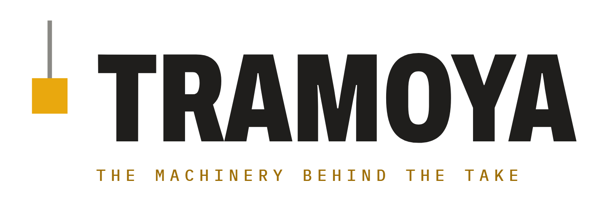
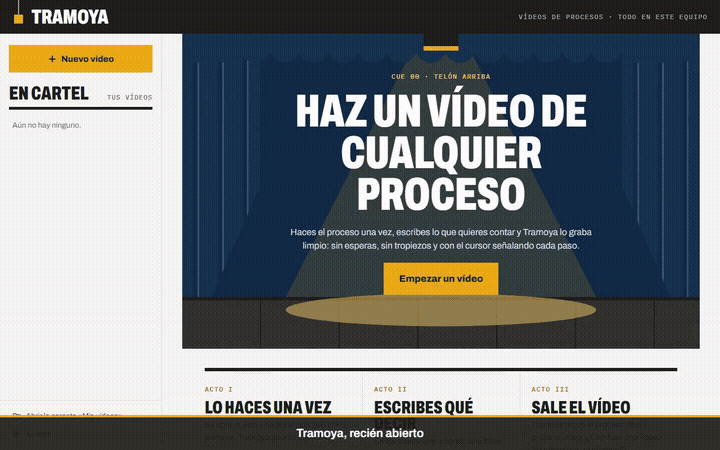
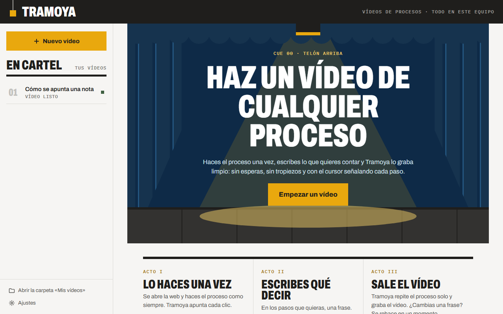
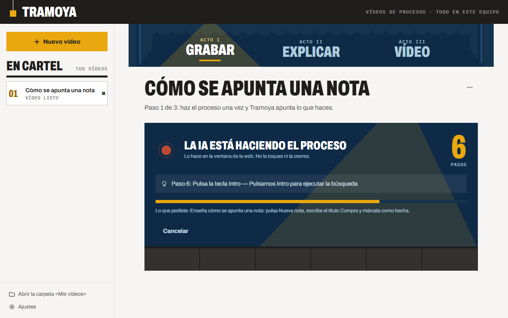
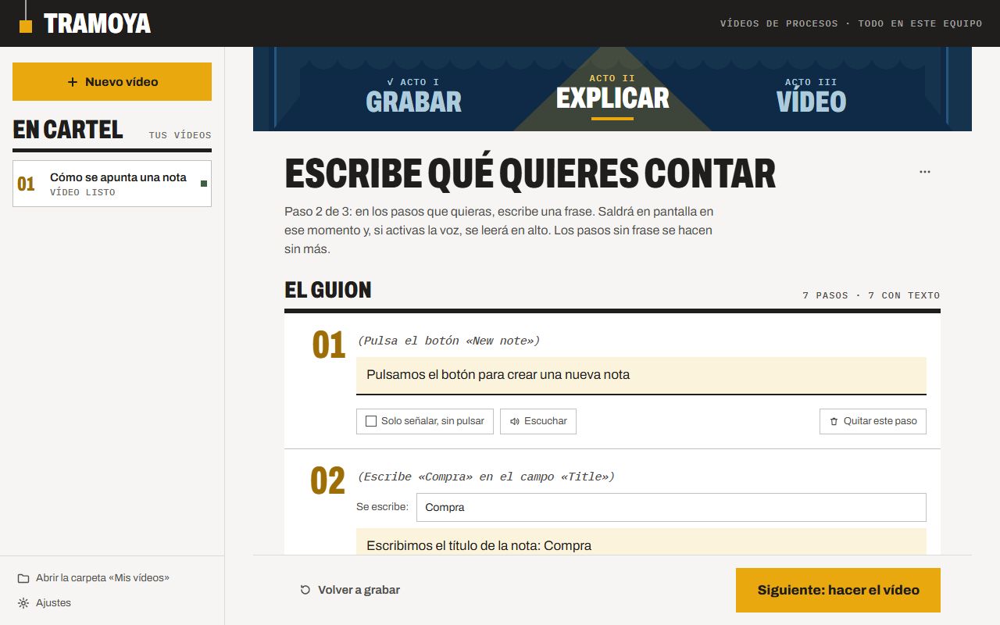
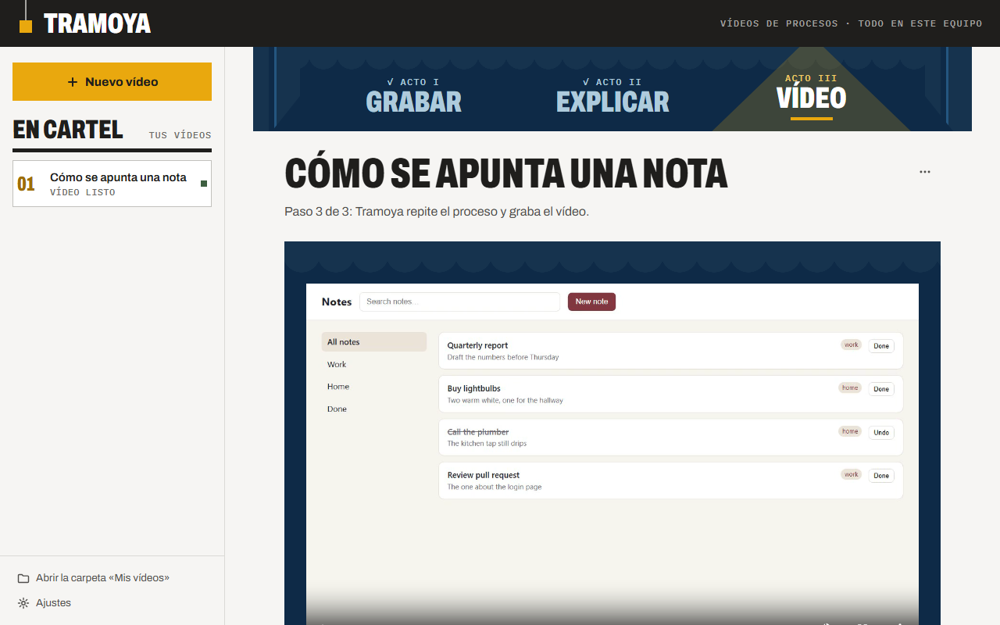
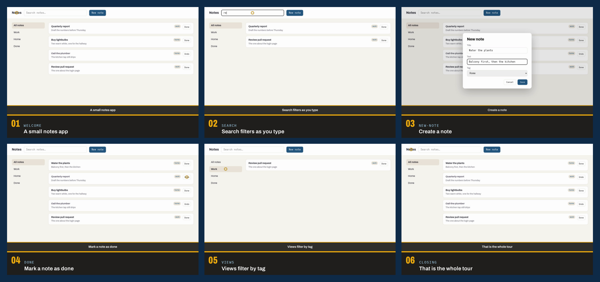
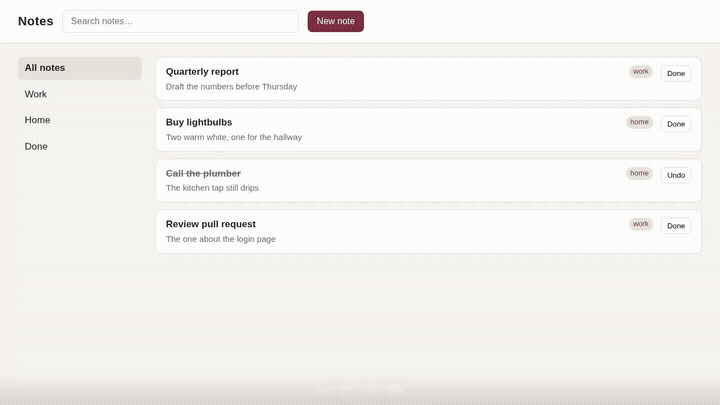
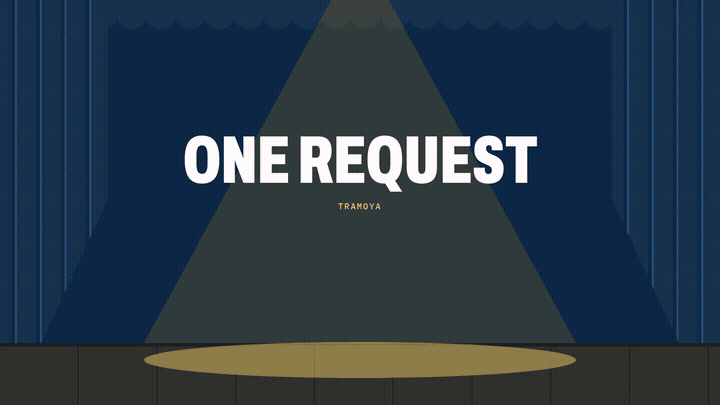
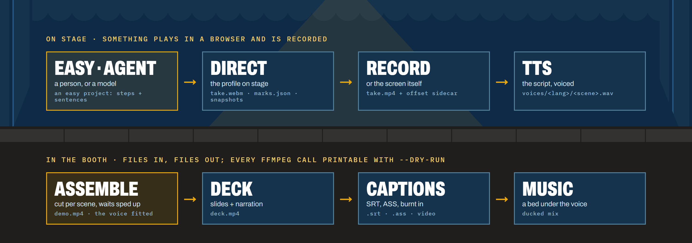

<div align="center">

<picture>
  <source media="(prefers-color-scheme: dark)" srcset="assets/logo-dark.png">
  
</picture>

<p>
<em>The <strong>tramoya</strong> is the machinery of a theatre: the battens, the ropes, the counterweights, the trapdoors.<br>
The audience never sees it. The show runs on time because of it.</em>
</p>

<p><strong>Narrated videos of how a web application is used,<br>made from a process done once, described in a sentence, or asked as a question.</strong></p>

<p>
  
  
  
  
  
</p>

<a href="#tutorial"><strong>Tutorial</strong></a> ·
<a href="#your-first-video"><strong>First video</strong></a> ·
<a href="#describe-it-or-ask"><strong>AI agent</strong></a> ·
<a href="#the-stage"><strong>The stage</strong></a> ·
<a href="#capabilities"><strong>Capabilities</strong></a> ·
<a href="#a-demo-as-a-file"><strong>Demo as a file</strong></a> ·
<a href="#in-ci"><strong>In CI</strong></a> ·
<a href="#the-assistant"><strong>Assistant</strong></a> ·
<a href="#pipeline"><strong>Pipeline</strong></a> ·
<a href="#architecture"><strong>Architecture</strong></a> ·
<a href="#install"><strong>Install</strong></a> ·
<a href="#verification"><strong>Verification</strong></a> ·
<a href="#status-and-limits"><strong>Limits</strong></a>

</div>

---

## What it is

A help video is usually somebody sharing their screen, talking over it, clicking twice where once would do, and
waiting on a spinner in silence. It is out of date with the next release, and nobody records it again.

Tramoya separates the *process* from the *recording*. The process is a list of steps on a real web page (click,
type, choose, point at) with a sentence for each one. The recording is produced from that list: a browser replays
the steps with a visible cursor, captions and no mistakes, a voice reads the sentences, and the cut fits each scene
to its narration and compresses the waits. When the application changes, the video is made again from the same
list.

There are three ways to get the list:

| | You | Tramoya |
|---|---|---|
| **Record** | do the process once in a browser | writes each click as a step with a durable selector and a sentence you can edit |
| **Describe** | write one sentence: *«show how a note is added and marked as done»* | a language model does it on the real page, step by step, and writes what the voice will say |
| **Ask** | write a question: *«where do I see the notes I have finished?»* | the model takes you there, points at the answer without pressing it, and explains it |

It ships as two implementations of the same tool that read and write the same files:

- **Windows**: `Tramoya.exe`, one program in C#/.NET 9 with a window, its own Chromium and ffmpeg, the Windows
  voices and the AI agent. Nothing to install, no administrator rights.
- **Linux and macOS**: the `tramoya` Python package, a command-line pipeline with a zero-dependency core, Kokoro
  voices, and the same window in a browser.

Everything runs on your machine. No account, no cloud service, no telemetry; the AI features work with a model on
the same computer.

---

<a id="tutorial"></a>

## Tutorial

Three minutes, in Spanish, of the Windows application. Tramoya recorded it: a profile drives the application's own
window on a clean install, the Windows voice reads the narration, `assemble` cuts it. Inside the tutorial, the AI
records a second video of its own on the notes app of the examples. Nothing in either video was edited by hand.

<p align="center">
  <a href="assets/video/tramoya-tutorial.mp4"></a>
</p>

<p align="center"><sub>Preview without sound.
<a href="assets/video/tramoya-tutorial.mp4"><b>Tutorial with narration</b></a> (3:09) ·
<a href="assets/video/tutorial-the-ai-made-this.mp4"><b>The video the AI made inside it</b></a> ·
<a href="assets/video/ask-where.mp4"><b>A question answered by the AI</b></a> (0:22)</sub></p>

The window is a small theatre. The home screen raises the curtain; the three steps are three acts with the
spotlight on the one in progress; the steps of a video are a script, each with its stage direction in brackets and
the line the voice will say; the AI and the finished video come out on stage.

<p align="center">
  
  
  
  
</p>

<p align="center"><sub>Curtain up · the AI on stage · the script · the premiere. Screenshots of the window itself.</sub></p>

| In the tutorial | What it shows |
|---|---|
| Settings | A Windows voice and its speed, a preview, optional subtitles, and the domains allowed to use Windows sign-in. |
| A new video | A name and the address of any web page: an intranet, a SaaS tool, an application on `localhost`. |
| «O pídeselo a la IA» | One paragraph typed into the window. The model opened the page, made seven correct steps and wrote the sentence of each. |
| The script it wrote | The same review screen as a recorded process: every sentence can be changed, every step removed or set to *point without pressing*. |
| The video | Replayed, voiced and cut, with an `.srt` next to it. Any wait longer than twenty seconds is compressed to a few, with a caption that says how long it took. |

[`examples/tramoya-sobre-tramoya/`](examples/tramoya-sobre-tramoya) is that tutorial as a profile and a script:
`bash grabar.sh` makes it again.

---

<a id="your-first-video"></a>

## Your first video, step by step

For a person who knows the process (how to file an expense, approve a request, set up a report) and has never
opened a terminal. Windows, no administrator rights, nothing to install. The window is in Spanish; button names are
quoted as they appear.

**1. Download.** From the [v1.2.0 release](https://github.com/gitsual/tramoya/releases/tag/v1.2.0), take
`Tramoya-1.2.0-windows.zip` (about 545 MB: the program, its own Chromium and ffmpeg, so nothing is downloaded
later). On a network that cuts large downloads, take the six parts `….zip.part0` to `part5` and `unir.bat`, put them
in one folder and double-click `unir.bat`; it joins the parts and unzips them.

**2. Open.** Unzip anywhere and double-click `Tramoya.exe`. The program is not code-signed yet, so the first time
Windows SmartScreen shows a warning: *Más información* → *Ejecutar de todas formas*. Settings, projects and finished
videos (in *Mis vídeos*, next to `Tramoya.exe`) are kept inside that folder: it can be moved or copied to a USB
drive, and deleting it removes everything.

**3. Act I, record (*Grabar*).**
- *Empezar un vídeo*: a name («Cómo se pide un día libre») and the address of the page.
- *Abrir la web*: a browser opens. Sign in as usual and go to where the process starts.
- *Empezar a grabar*, and do the process once. Mistakes can be removed afterwards.
- *Ya he terminado*, or close that browser.

> [!NOTE]
> Nothing is recorded before *Empezar a grabar*, so a password never ends up in a step or a video. The browser keeps
> the session, so the next video starts signed in.

**4. Act II, the script (*Explicar*).** Each click, typed value and choice comes back as a stage direction
(«(Pulsa el botón «Guardar»)»). Write under each one what the narrator should say there, and listen to it. A typed
value can be changed (a sample name instead of a real one), steps can be removed, and a button can be set to
*solo señalar*: the video points at it without pressing it. The last button that saves is set that way by default,
so making the video never submits anything twice.

**5. Act III, the video (*Vídeo*).** Choose the voice and press *Hacer el vídeo*. Tramoya replays the steps on the
page by itself, reads the sentences and assembles the video; *Abrir el vídeo* plays it. If a step fails, the window
names it, gives the reason and opens it. When the application changes, the same project makes the new video.

**Or describe it.** With a model available (see [below](#describe-it-or-ask)), the first act shows the card
*O pídeselo a la IA*. Describe the process as you would to a colleague, and the model does it on the real page and
leaves the script ready for Act II, to be reviewed as if it had been recorded.

**Or ask.** Type a question («¿Dónde veo las notas que ya he terminado?») and the model does not run a process: it
goes to the place, points at the element, says what it is for, and the answer closes the video.

<details>
<summary><b>When something goes wrong</b></summary>

| Message or symptom | What to do |
|---|---|
| «La sesión ha caducado» | *Abrir la web*, sign in again, close the browser, and make the video again. |
| A step fails («no encuentro…») | The page changed, or the step was a one-off (a dialog that appears only sometimes). Remove or record that step again. |
| The window opens blank on a managed laptop | The window uses the Edge engine with no proxy, because it only talks to `127.0.0.1`. If a policy still blocks it, that is the address to allow. |
| SmartScreen or an antivirus stops `Tramoya.exe` | The executable is not signed yet. *Ejecutar de todas formas*, or ask for it to be allowed. |
| The voice sounds mechanical | *Ajustes*: another voice, a slower speed. Windows installs more voices under *Settings → Time & language → Speech*. |
</details>

<details>
<summary><b>La misma guía, en español</b></summary>

Para quien sabe hacer el proceso y nunca ha abierto una terminal. Windows, sin permisos de administrador, sin
instalar nada.

1. **Descarga.** De la [versión 1.2.0](https://github.com/gitsual/tramoya/releases/tag/v1.2.0), baja
   `Tramoya-1.2.0-windows.zip` (unos 545 MB, lo lleva todo dentro). Si tu red corta las descargas grandes, baja las
   seis partes `….zip.part0` … `part5` y `unir.bat` a la misma carpeta y haz doble clic en `unir.bat`.
2. **Abre.** Descomprime donde quieras y haz doble clic en `Tramoya.exe`. La primera vez Windows avisa de que no está
   firmado: *Más información* → *Ejecutar de todas formas*.
3. **Acto I, grabar.** *Empezar un vídeo*, un nombre y la dirección de la web. *Abrir la web*, entra con tu usuario y
   ve hasta donde empieza el proceso. Pulsa *Empezar a grabar* y hazlo una vez. Antes de ese botón no se apunta nada:
   tu contraseña nunca sale en un vídeo.
4. **Acto II, el guion.** Cada paso vuelve como una acotación. Escribe debajo lo que dirá la voz y escúchalo; cambia
   un valor (un nombre de ejemplo en vez del real), quita los pasos que sobran o marca un botón como *solo señalar*.
5. **Acto III, el vídeo.** Elige la voz y pulsa *Hacer el vídeo*. En un par de minutos está en la carpeta
   *Mis vídeos*, con sus subtítulos al lado. Cuando cambie la web, se vuelve a hacer desde el mismo proyecto.

**O pídeselo a la IA:** describe el proceso como se lo pedirías a un compañero; la IA lo hace en la web y te deja el
guion con sus frases para revisarlo. **O pregúntale** «¿dónde está…?»: te lleva hasta allí, lo señala y lo explica.
</details>

---

<a id="describe-it-or-ask"></a>

## Describe it, or ask: the agent

The window records what a person clicks. The agent records what a **model** clicks. Each turn it observes the page,
decides one action, performs it, and writes the sentence of that step:

1. **Observe.** Every interactive element of the page (in frames too) gets a number, a role, a name, its value and
   its state; the text visible on screen comes first, then the rest of the page. The model never sees raw HTML.
2. **Decide.** The model answers in strict JSON: `{pensamiento, accion, ref, valor, frase, resumen}`. Actions are
   `clic`, `señalar`, `escribir`, `elegir`, `tecla`, `ir`, `esperar`, `terminar` and `fallo`. An invalid answer goes
   back to the model with the reason, and four failed actions in a row end the run.
3. **Act and record.** The action runs through Playwright, and the element is stored with a durable selector from
   Playwright's own generator (role and accessible name first, never generated ids). The result is an ordinary
   project of the window: the same script to review, the same video.

If the objective is a question (it starts with *¿*, *dónde*, *cómo*, *qué*, or ends with *?*), the agent switches
to **question mode**: it changes nothing on the page, navigates to the answer, uses `señalar` (hover and point, never
press), and the answer is spoken at the end of the video.

```
Tramoya.exe agent "Enseña cómo se apunta una nota: pulsa Nueva nota, escribe el título Compra y el texto Leche y pan, guárdala, búscala y márcala como hecha" --url http://127.0.0.1:8770/index.html --video --voz
Tramoya.exe agent "¿Dónde veo las notas que ya he terminado?" --url http://127.0.0.1:8770/index.html --video --voz
```

| Measured on the notes example, local `qwen3-coder:30b` through Ollama | Result |
|---|---|
| The process of the tutorial, described in one paragraph, in three recordings | 7 steps every time, all correct, each with its sentence |
| The same question, asked five times | 5 of 5 opened the *Done* view and answered; each points at a finished note's *Undo* button rather than at the list |
| A model answer that broke the protocol (a repeated JSON key) | recovered on the next turn; since 1.0 a repeated key is accepted |

| Backend | Selection | Default model |
|---|---|---|
| Ollama, local | default; `--backend ollama`; `OLLAMA_HOST` | `qwen3-coder:30b` |
| Claude API | `ANTHROPIC_API_KEY`; `--backend claude` | `claude-sonnet-5-5` |

Options: `--model`, `--max-pasos`, `--nombre`, `--video`, `--voz`, `--capturas` (sends a screenshot to models that
accept images), `--dry-run`. `TRAMOYA_HEADLESS=1` runs every browser without a window: the tutorial and the question
above were recorded that way while the machine was in use. Without a model, the window hides the AI card and nothing
else changes. The model reads what the page says, so buttons with visible text, `aria-label` or `title` give better
videos and better answers.

**When the job is the task itself, not the video:** [faena](https://github.com/gitsual/faena), tramoya's sibling,
does errands in the background on a web or a Windows program without taking the screen, stops before anything that
cannot be undone, writes a report with a photo of each step and learns what went well as skills. It can learn a skill
from a tramoya project.

---

<a id="the-stage"></a>

## The stage

What Tramoya puts on the page while it records, the same in both implementations: a yellow ring for the cursor that
travels between targets instead of jumping, a ripple on every click, and a caption band in ink with a yellow edge for
the sentence of the scene. All of it is `pointer-events: none`, so it never takes a click from the application.
Long waits become a few seconds with a caption in the same colours.

<p align="center">
  <a href="examples/notes-app/tramoya.toml"></a>
</p>

<p align="center"><sub>One frame per scene of the notes demo, cut from the take at the midpoint of each scene in
<code>marks.json</code> (<code>scripts/render_brand.py filmstrip</code>).</sub></p>

---

<a id="capabilities"></a>

## Capabilities

| | `Tramoya.exe` (Windows) | `tramoya` (Linux, macOS) |
|---|---|---|
| Window: record, script, video (`easy`) | WebView2 window | the same page, in a Chromium `--app` window |
| AI agent: describe or ask (`agent`) | yes | no |
| Profiles as files, step language, `direct` | yes | yes |
| Recording | the browser records itself | the browser itself, or the screen with `wf-recorder` (Wayland) |
| Voice | Windows voices (SAPI), offline | Kokoro (English, Spanish), offline |
| Assembly, decks, captions, music | yes | yes |
| Accessibility snapshot per scene and `snapshots diff` | yes | yes |
| Assistant: a sentence becomes commands (`ask`, `do`) | yes | yes |
| `init`, `import`, `login`, `cues`, `marks` | yes | yes |
| `capture` (record through `playwright codegen`) | no: the window is the recorder | yes |
| Distribution | one folder, unzip and run | `pip install` from the tag |

Files are interchangeable: `tramoya.toml`, `marks.json`, `script.json`, the step language and the window's projects.
A profile written on one system runs on the other, and the accessibility snapshots of the same profile match between
the two implementations.

---

<a id="a-demo-as-a-file"></a>

## A demo as a file

For developers, a demo is a `tramoya.toml` in the repository: where the application is, how to reach it, and the
scenes as one-line steps.

<p align="center">
  <a href="assets/video/notes-demo.mp4"></a>
</p>

<p align="center"><sub>The notes example: six scenes from <a href="examples/notes-app/tramoya.toml"><code>tramoya.toml</code></a>, the English
Kokoro voice, cut by <code>assemble</code>. <a href="assets/video/notes-demo.mp4"><b>Video with narration</b></a>.</sub></p>

```toml
[app]
name = "Notes"
launch = "python -m http.server 8770 --bind 127.0.0.1"   # optional: Tramoya starts it and waits for `url`
url = "http://127.0.0.1:8770/index.html"
viewport = [1280, 720]
# storage_state = ".tramoya/auth.json"                     # a saved session, for applications behind a login

[demo]
languages = ["en", "es"]
pace = 1.0

[[scene]]
name = "search"
label = "Search filters as you type"
steps = ["type #search | re", "say 5", "point .note .title", "beat 1", "clear #search"]

[scene.narration]
en = "Typing in the search box filters the list as you go."
es = "Al escribir en el cuadro de búsqueda la lista se filtra al momento."
```

```bash
tramoya direct tramoya.toml --out out --dry-run     # the plan, scene by scene; nothing opens
tramoya direct tramoya.toml --out out               # take.webm · marks.json · script.json · snapshots/<scene>.txt
tramoya direct tramoya.toml --out out --url https://staging.example.com/   # the same scenes on another deployment
```

| Step | Effect |
|---|---|
| `click <selector>` · `click_text <text>` | Move the cursor there, show the click, click. Selectors are Playwright's: CSS, `text=`, `role=button[name="Save"]`. |
| `type <selector> \| <text>` · `select <selector> \| <value>` · `clear <selector>` | Fill a field, choose an option, empty a field. |
| `point <selector>` | Scroll it into view and rest the cursor on it, without clicking. |
| `scroll <px>` · `press <key>` · `goto <path>` | Scroll, press a key, navigate relative to the application URL. |
| `say [seconds]` | Play the scene's narration in the chosen language, or wait when there is no clip yet. |
| `beat <seconds>` | A pause, scaled by `pace`. |
| `wait <selector> \| <max seconds>` | Wait for something slow and mark it as a wait window; the assembly speeds it up and captions it. |

**Writing the file.**

| | Command | When |
|---|---|---|
| Interview | `tramoya init <dir>` | A short set of questions (each has a flag, so it runs in CI with `--no-interactive`). Writes `tramoya.toml`, `script.json` and a `Makefile`. |
| Browser | `tramoya capture <url> --into tramoya.toml` | Records clicks through `playwright codegen`, one scene per page. Python only; on Windows, the window does this. |
| Import | `tramoya import flow.json --into tramoya.toml` | From a Chrome DevTools Recorder export or a `playwright codegen` Python file. |

<p align="center">
  
</p>

**Behind a login.** `tramoya login <url> --out .tramoya/auth.json` opens a browser; you sign in and press Enter;
cookies and local storage are saved as a Playwright session file that the profile references with `storage_state`.
The password never passes through Tramoya.

**A snapshot per scene.** Each `direct` run writes `snapshots/<scene>.txt`, the accessibility tree of the page at the
end of the scene:

```
- banner:
  - heading "Notes" [level=1]
  - textbox "Search notes"
  - button "New note"
- main:
  - article:
    - text: Quarterly report Draft the numbers before Thursday work
    - button "Done"
```

`tramoya snapshots diff approved/ out/snapshots` compares them with an approved set: a renamed button, a missing
element or a scene that did not run is reported as a unified diff with a non-zero exit code, before a video of the
wrong build is published. This repository runs that check on its own example.

For cases a step cannot express, the same scenes can be written in Python
([`examples/notes-app/director.py`](examples/notes-app/director.py)): scenes are functions that receive the stage and
a `say` callback.

---

<a id="in-ci"></a>

## In CI

A screen recording captures what someone did once. A profile produces a video of what the current build does, on
every run. [`examples/`](examples/README.md) has a runnable profile and a workflow for each of these uses.

| Use | Problem | What Tramoya adds | Example |
|---|---|---|---|
| Validation evidence in regulated QA | Guidance such as the FDA's Computer Software Assurance draft accepts a recording of the run as objective evidence, if it is a recording of the build under test. | One scene per test step, labelled with its id; the snapshot of each step compared with the approved set; take, marks and snapshots kept together. | [`validation-evidence/`](examples/validation-evidence) |
| Release-note video per tag | The changelog is generated in CI; the video is not, so it ships late or never. | A workflow on `v*` tags records the changelog scenes against the tagged build and attaches one video per language. | [`release-notes/`](examples/release-notes) |
| Support knowledge base | Each interface change silently outdates a help video. | Short "how do I" scenes regenerated nightly against `main`. | [`support-kb/`](examples/support-kb) |
| Localized onboarding | Recording again per language is where training-video cost goes. | One take, one `tts` and `assemble` per language; the cut adapts to each voice. | [`localized-onboarding/`](examples/localized-onboarding) |
| Product demos | Recorded demos drift from the product between releases. | Recorded again on each release from the same profile. | any profile with `--url` |

The sources behind this table, and which figures could not be confirmed, are in
[`docs/research/2026-09-28-target-app-interactive-setup-enterprise-value.md`](docs/research/2026-09-28-target-app-interactive-setup-enterprise-value.md).

---

<a id="the-assistant"></a>

## The assistant: commands from a sentence

The agent drives the page. The assistant plans the *commands*: a request in plain language becomes a plan of
`tramoya` commands, checked against the files that exist, and nothing runs without confirmation.

<p align="center">
  
</p>

```bash
tramoya ask "put some quiet background music under demo.mp4"     # shows the plan, runs nothing
tramoya do  "build the video with the English voice"             # shows the plan, asks, runs it
tramoya do  "…" --yes --dry-run                                  # runs it, every ffmpeg call only printed
```

- The model sees the command reference and the files in the directory, and answers in strict JSON. An invalid answer
  gets one repair round.
- **Preflight** rejects a plan before anything runs: a missing input, a language without voices, a file used as a
  script that is not one. It knows what each step produces, so `assemble` may use the `take.webm` that `direct` will
  write two steps earlier.
- Only `tramoya` commands are executed, in order, stopping at the first failure. Nothing the model writes reaches a
  shell.

The recording above is one real session with `qwen3-coder:30b`, kept as it came out. Asked to translate the video
into French, the model planned «French voiceovers» with `--lang es`. Preflight accepted it, because it checks that the
plan's language has a voice, not that it is the language that was asked for. That is the reason `ask` shows the plan
and `do` asks before running it.

**One request, start to finish.** An empty folder with the notes app's three sources, and one sentence: the
assistant plans `direct`, `tts` and `assemble`, and runs them for real.

<p align="center">
  <a href="assets/video/walkthrough.mp4"></a>
</p>

<p align="center"><sub><a href="assets/video/walkthrough.mp4"><b>The walkthrough with sound</b></a>: the request, the run, and the video it produced.</sub></p>

Same backends as the agent: Ollama locally by default, Claude when `ANTHROPIC_API_KEY` is set.

---

<a id="pipeline"></a>

## Pipeline

On stage, something plays in a browser and is recorded. In the booth, nothing is live: every step reads files and
writes files, and every ffmpeg call can be printed instead of run.

<p align="center"></p>

```
agent    an objective or a question          ──▶  a project of the window: steps with selectors and sentences
easy     the window: record, script, video    ──▶  video.mp4 + .srt
ask/do   a request in plain language          ──▶  a checked plan of the commands below

direct   profile or director script           ──▶  take.webm, marks.json, script.json, snapshots/
record   wf-recorder + offset sidecar         ──▶  take.mp4, take.mp4.offset.json
tts      script.json                          ──▶  voices/<lang>/<scene>.wav

assemble take + marks + voices                ──▶  demo.mp4: waits compressed, voice fitted per scene
deck     slides + voices (+ a clip)           ──▶  deck.mp4: each slide as long as its narration
captions cues or .srt                         ──▶  .ass, or a video with burnt-in captions
music    a generated bed                      ──▶  the video with music ducked under the voice
```

**`marks.json`** is the timeline: `scene:<name>:start|end` and `wait:start|end`, in seconds since the director
started, written to disk after every mark so that an interrupted take keeps its timeline.

```json
[
  {"t": 0.00,  "key": "scene:welcome:start", "label": "A notes app"},
  {"t": 8.92,  "key": "scene:welcome:end",   "label": "A notes app"},
  {"t": 40.0,  "key": "wait:start",          "label": "backend"},
  {"t": 114.0, "key": "wait:end",            "label": "backend"}
]
```

**`assemble`, per scene:** cut `[start, end)` from the take (shifted by the recorder offset when there is one);
speed up any wait longer than 20 seconds to about 4, with a caption giving the real duration; freeze the last frame
if the voice is longer than the scene, pad with silence if it is shorter; normalise the voice to 48 kHz; concatenate
once. Every ffmpeg call goes through a `Runner` that, with `--dry-run`, prints the exact arguments and encodes
nothing, which is what makes the pipeline testable without encoding.

<p align="center">
  
</p>

```bash
tramoya tts --script script.json --lang en --out-dir voices/en
tramoya assemble --video take.webm --marks marks.json --voice-dir voices/en --out demo.mp4 --dry-run
tramoya deck --slides slides/ --voice-dir voices/en --clip demo.mp4 --clip-duration 59 --out deck.mp4
tramoya captions burn --video deck.mp4 --subtitles deck.srt --out deck-captions.mp4 --trim 0-120,600-780
tramoya music bed --out bed.wav && tramoya music mix --video deck-captions.mp4 --bed bed.wav --out final.mp4
tramoya cues marks --cues take.cues --meta take.meta --duration 297.4 --out marks.json   # a single continuous take
```

---

<a id="architecture"></a>

## Architecture

Two implementations, one specification. The Python package is the reference: each C# file is the port of a Python
module with the same names and the same output, and the Python tests were ported as the C# tests.
[`windows/ARQUITECTURA.md`](windows/ARQUITECTURA.md) is the contract between them.

```
src/tramoya/                          Python, Linux and macOS
├── marks.py       timeline, flushed after every mark; reads older formats
├── pacing.py      tempo, language, rehearsal mode
├── narration.py   script, narrator, clip lengths
├── stage.py       Playwright page with the cursor ring, click ripple and caption band  [playwright]
├── profile.py     tramoya.toml, the step language
├── director.py    runs a profile: marks, script, snapshots                            [playwright]
├── snapshots.py   accessibility snapshots and their diff
├── wizard.py      init: interview or flags
├── recording.py   DevTools Recorder and codegen imports
├── record.py      wf-recorder with an offset sidecar read from /proc
├── cues.py        single-take cue files to marks or ASS
├── tts.py         Kokoro                                                              [tts]
├── ffmpeg.py      Runner(dry_run), filter recipes as pure functions
├── assembly.py    per-scene cut, wait compression, voice fitting, decks
├── captions.py    SRT and ASS, burn-in, trimming
├── audio.py       generated music bed, ducking
├── assistant.py   ask / do: backends, preflight, plan execution
├── easy/          the window: HTTP server, recorder, steps, voice, srt; ui/ with its fonts [easy]
└── cli.py         17 subcommands (the Windows CLI adds `agent`)

windows/                              C#, .NET 9
├── Tramoya.Core    the Python modules above, ported one to one
├── Tramoya.Stage   Playwright for .NET: stage, director, recorder
├── Tramoya.Voice   SAPI through COM
├── Tramoya.Easy    the engine and local server of the window
├── Tramoya.Agent   observer, protocol, Ollama and Claude backends, agent loop
├── Tramoya.App     Tramoya.exe: WebView2 window and the CLI
└── Tramoya.Tests   xUnit
```

Anything that runs ffmpeg goes through `Runner`; anything that needs Playwright, Kokoro or a model is behind an
optional dependency or an injectable function, so tests never open a socket or encode unless they are meant to.

---

<a id="install"></a>

## Install

**Windows.** Download `Tramoya-1.2.0-windows.zip` from the
[release](https://github.com/gitsual/tramoya/releases/tag/v1.2.0), unzip, run `Tramoya.exe`. Everything it needs is
in the folder: `Tramoya.exe`, the Playwright driver, Chromium, ffmpeg and the licences of the fonts. Data and videos
stay in the folder. The command line is the same executable:

```
Tramoya.exe                                     the window
Tramoya.exe direct tramoya.toml --out out       any subcommand; the console attaches when there are arguments
Tramoya.exe tts --script out/script.json --lang es --out-dir out/voices/es
Tramoya.exe agent "<objective or question>" --url <page> --video --voz
```

**Linux and macOS.** Pin the tag: the package is installed from git and the tag is the contract.

```bash
pip install "tramoya @ git+https://github.com/gitsual/tramoya@v1.2.0"                       # core, no dependencies
pip install "tramoya[playwright,tts,easy] @ git+https://github.com/gitsual/tramoya@v1.2.0"  # stage, voice, window
python -m playwright install chromium
```

External programs are looked up only by the command that needs them: `ffmpeg` and `ffprobe` for assembly, decks,
captions and music; `wf-recorder` for `record` (Wayland); a Chromium for `direct` and `easy`; Ollama or an Anthropic
key for `ask` and `do`.

<details>
<summary><b>Arch Linux · Debian/Ubuntu · macOS</b></summary>

```bash
sudo pacman -S ffmpeg wf-recorder libpulse                       # Arch
sudo apt install ffmpeg wf-recorder pulseaudio-utils             # Debian / Ubuntu
python -m playwright install --with-deps chromium
brew install ffmpeg                                              # macOS: use direct; record is Wayland only
```
</details>

**Building the Windows kit** (requires the .NET 9 SDK):

```powershell
dotnet test windows/Tramoya.Tests -c Release
powershell -File windows/publish.ps1 -Ffmpeg <folder with ffmpeg.exe and ffprobe.exe>   # -> windows/dist/Tramoya-1.2.0-windows.zip
```

**Rendering this page's assets.** `scripts/render_brand.py` draws the logos, the diagram, the cards and the
filmstrip from HTML with the window's fonts; `scripts/render-assets.sh` records the demo, the terminal GIFs
(asciinema and agg, in the palette of `assets/theme.conf`) and the walkthrough.

---

<a id="verification"></a>

## Verification

| Suite | Command | Result for 1.2.0 |
|---|---|---|
| Python, fast | `python -m pytest -q` | 306 passed, on Linux and on Windows; nothing encoded, no network |
| Python, slow | `python -m pytest -q -m slow` | 1 passed: three real seconds through the whole pipeline |
| C#, with browser tests | `TRAMOYA_BROWSER_TESTS=1 dotnet test windows/Tramoya.Tests -c Release` | 531 passed, 14 skipped (Linux-only: `/proc`, `wf-recorder`, Python director) |
| Cross-implementation | the notes profile through both, then `snapshots diff` | snapshots match |
| End to end | the [tutorial](#tutorial), the question, the notes demo and the walkthrough | recorded, voiced and assembled by the released program |

Every picture on this page is the program's own output, or drawn from HTML by `scripts/render_brand.py` (the logos,
the diagram, the filmstrip's frame). The window screenshots are the window; the terminal GIFs are asciinema
recordings of the installed command; the videos were directed, voiced and cut by Tramoya.

---

<a id="status-and-limits"></a>

## Status and limits

Version 1.2.0. The file formats (`tramoya.toml`, `marks.json`, `script.json`, the step language, the window's
projects) are stable since 1.0.

- **The Windows executable is not code-signed.** SmartScreen warns the first time; environments that only allow
  signed software will block it until it is.
- **The window is in Spanish.** The command line, the profiles and the narration support English and Spanish.
- **The window on Linux and macOS has no voice.** Its narration uses Windows voices, so there it produces videos with
  captions only; the command-line pipeline uses Kokoro on every system.
- **Voices.** Windows uses the voices installed in Windows. Kokoro ships English and Spanish here; `preflight`
  refuses a plan for a language without a voice instead of producing a silent video.
- **The agent needs a model** and is as good as the model and the page's labels. With `qwen3-coder:30b` it handles
  the processes and questions shown here; a page whose buttons have no text or accessible name is harder for it. Its
  output is always a project to review, never a video published without a person seeing the steps.
- **The assistant can misread a request.** Preflight catches plans that cannot run (missing files, a language without
  voices), not plans that run but answer another question; read the plan before saying yes.
- **New tabs** opened by the page are not followed by the recorder.
- **`record` is Wayland only.** `direct` records inside the browser and works wherever Playwright does.
- **Selectors depend on the page.** When the markup changes, the failing step is named, and the snapshot diff shows
  what changed.

---

<div align="center">
<sub>MIT licence. The fonts of the window, Archivo and IBM Plex Mono, are under the SIL Open Font License 1.1
(<code>src/tramoya/easy/ui/fonts/</code>). One program, two implementations, the same files.</sub>
</div>
